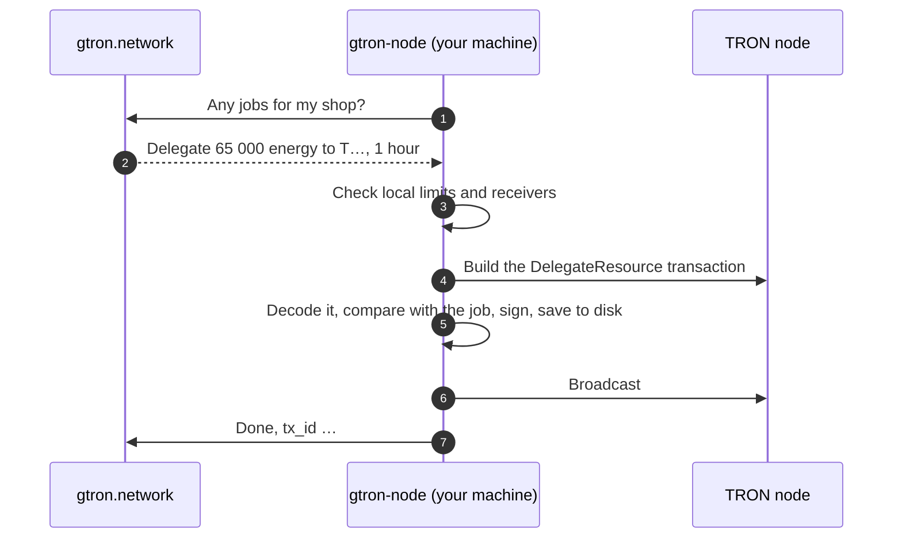

<div align="center">

<picture>
  <source media="(prefers-color-scheme: dark)" srcset=".github/assets/logo-dark.svg">
  
</picture>

### gtron-node

**Rent out your TRON energy on [gtron.network](https://gtron.network). Your private key never leaves your machine.**

[](https://github.com/Gtron-Enegry/gtron-node/releases/latest)
[](https://github.com/Gtron-Enegry/gtron-node/actions/workflows/ci.yml)
[](LICENSE)


**English** · [Русский](README.ru.md) · [简体中文](README.zh-CN.md)

</div>

---

## Install in one command

```sh
curl -fsSL https://gtron.network/install-node.sh | sh
```

The installer picks the build for your system, checks it against the release's `SHA256SUMS`, installs `gtron-node` and opens the setup wizard. Five minutes later the agent is running as a background service.

> [!TIP]
> Prefer to read before you run? The installer is [`install.sh`](install.sh) in this repository, plain POSIX sh. It only downloads from this repository's [releases](https://github.com/Gtron-Enegry/gtron-node/releases).

<details>
<summary><b>Installer options</b></summary>

```sh
curl -fsSL https://gtron.network/install-node.sh | sh -s -- --version 1.2.3   # a specific release
curl -fsSL https://gtron.network/install-node.sh | sh -s -- --no-setup        # binary only
curl -fsSL https://gtron.network/install-node.sh | sh -s -- --dir ~/bin       # install location
```

</details>

## What you need

| | |
|---|---|
| **A shop on gtron.network** in *agent* mode, and a provider API key (`pk_live_…`) with the `jobs` scope. Cabinet → Shop → API keys. | 🏪 |
| **A TRON wallet** with staked TRX: its private key in hex, as TronLink exports it. | 👛 |
| **A machine that stays on:** Linux (any distribution, x86_64 or arm64) or macOS (Apple Silicon or Intel). A small VPS is plenty. | 🖥️ |
| **Outbound HTTPS only.** No open ports, no public IP, no domain. | 🔒 |

## The setup wizard

`gtron-node setup` asks a few questions and does the rest. You can run it again at any time to change the answers.

| Step | What it asks | Good to know |
|:---:|---|---|
| 1 | **Platform API** | Press Enter for `https://api.gtron.network`. |
| 2 | **Shop API key** | Checked with the platform right away. Typed hidden. |
| 3 | **Wallet private key** | Typed hidden, stored in a file only the agent can read. The wizard shows the wallet address for you to confirm. |
| 4 | **Wallet link** | Adds the wallet to your shop and proves you own it by signing the platform's verification message. |
| 5 | **TRON node** | TronGrid (recommended; a free API key raises the rate limit) or your own full node. |
| 6 | **Receivers** | Anyone who rents from your shop, or only an allowlist of addresses. |
| 7 | **Safety limits** | Recommended values or your own. See [limits](#safety-limits). |
| 8 | **How to run** | A system service (systemd), Docker, a macOS background service (launchd) or by hand. Only the options your machine supports are listed. |

At the end the wizard prints where the settings, the state and the logs are, and the commands to manage the service.

## How it works



The agent connects out to the platform and waits for jobs. Each job is a delegation (or its return) that a client has paid for. The agent decides on its own whether to do it, and the platform cannot make it sign anything else.

## What the agent guarantees

| | |
|---|---|
| 🔑 **The key stays with you** | It is read from a file with owner-only permissions and used only to sign. It is never sent anywhere, and there is deliberately no command-line flag for it. |
| 🧾 **It signs exactly the job** | The transaction built by the TRON node is decoded and compared with the job field by field: type, wallet, receiver, resource, amount, lock. Anything else is refused. |
| 🛡️ **Your limits, not ours** | Per-delegation, per-24-hours and total-locked caps plus the receiver allowlist are checked on your machine. A compromised platform account cannot get past them. |
| 1️⃣ **One signature per job** | The signed transaction is saved to disk before it is broadcast. After a crash or a restart the same transaction is sent again; a second one is never signed. |
| 🌊 **Calm under failure** | If the platform or the TRON node is down, the agent backs off from 2 seconds up to a minute, so TronGrid will not ban your API key. |
| ⏹️ **Clean shutdown** | `SIGTERM` or Ctrl+C: the job in hand is finished first. A second Ctrl+C exits at once, which is also safe. |

The full list, including what the agent does *not* protect against, is in [SECURITY.md](SECURITY.md).

## Safety limits

| Limit | Variable | Recommended |
|---|---|---:|
| One delegation at most | `NODE_MAX_BALANCE_SUN` | 50 000 TRX |
| Delegated within any 24 hours | `NODE_MAX_DAILY_BALANCE_SUN` | 200 000 TRX |
| Locked at the same time | `NODE_MAX_LOCKED_BALANCE_SUN` | 500 000 TRX |
| Longest lock | `NODE_MAX_LOCK_SECONDS` | 30 days |

Amounts are in SUN in the settings file: 1 TRX = 1 000 000 SUN. A job above a limit is declined and goes to another shop.

## Everyday commands

<table>
<tr><th></th><th>Linux · systemd</th><th>Docker</th><th>macOS · launchd</th></tr>
<tr><td><b>Status</b></td><td><code>systemctl status gtron-node</code></td><td><code>docker compose ps</code></td><td><code>launchctl print gui/$(id -u)/network.gtron.node</code></td></tr>
<tr><td><b>Logs</b></td><td><code>journalctl -u gtron-node -f</code></td><td><code>docker compose logs -f</code></td><td><code>tail -f ~/.gtron-node/node.log</code></td></tr>
<tr><td><b>Restart</b></td><td><code>sudo systemctl restart gtron-node</code></td><td><code>docker compose restart</code></td><td><code>launchctl kickstart -k gui/$(id -u)/network.gtron.node</code></td></tr>
<tr><td><b>Settings</b></td><td><code>/etc/gtron-node/node.env</code></td><td><code>/opt/gtron-node</code> or <code>~/gtron-node</code></td><td><code>~/.gtron-node/node.env</code></td></tr>
<tr><td><b>State</b></td><td><code>/var/lib/gtron-node</code></td><td><code>./state</code> next to the compose file</td><td><code>~/.gtron-node/state</code></td></tr>
</table>

Docker commands run in the folder the wizard printed. Two more commands work everywhere:

```sh
gtron-node --check     # is everything ready? Reads only: takes, signs and sends nothing
gtron-node --address   # the wallet address of the configured key
```

`--check` prints the version, wallet, limits, the shop's state on the platform and the wallet's TRON balance, and exits with 0 when the agent is ready to take jobs.

## Upgrade

Run the installer again:

```sh
curl -fsSL https://gtron.network/install-node.sh | sh
```

It replaces the binary and restarts the service; settings and state stay. Jobs in progress continue where they stopped. For Docker, `docker compose pull && docker compose up -d` in the service folder.

If the platform sends a job type your version does not know, the agent declines it with a request to upgrade, and the order goes to another shop. Nothing breaks, you just miss those orders until you upgrade.

## The state directory

It holds the signed transactions and the record the 24-hour limit is counted from.

> [!IMPORTANT]
> **Keep it across upgrades and moves.** Without it the agent does not know what it has already signed: a job signed before the loss could be signed again, and the 24-hour limit starts from zero.
>
> **One directory, one agent.** A second agent on the same directory will not start. Do not run two agents with the same wallet and different directories.

## Without the wizard

Everything the wizard writes is an ordinary settings file, so you can manage it yourself.

<details>
<summary><b>Configuration file</b></summary>

Start from [`crates/node/dist/node.env.example`](crates/node/dist/node.env.example):

| Variable | Meaning |
|---|---|
| `NODE_API_URL`, `NODE_API_KEY` | Platform address and the shop's provider key (`jobs` scope) |
| `NODE_PRIVATE_KEY_FILE` | The wallet key file: hex, owned by the agent's user, mode `0400` |
| `TRONGRID_URL`, `TRONGRID_API_KEY` | Your TRON node, or TronGrid with an API key |
| `NODE_ALLOW_ANY_RECEIVER=1` or `NODE_ALLOWED_RECEIVERS=T…,T…` | Who may receive delegations; one of the two is required |
| `NODE_MAX_*` | [Safety limits](#safety-limits) |
| `NODE_LOCK_DELEGATIONS` | Lock delegations for the rental (default `true`); the platform counts only locked ones |
| `NODE_STATE_DIR` | State directory (default `.gtron-node`) |
| `RUST_LOG` | `error`, `warn`, `info` or `debug` |

The agent refuses to read a key file or settings file that other users can read.

```sh
gtron-node --config node.env --check
gtron-node --config node.env
```

</details>

<details>
<summary><b>systemd by hand</b></summary>

[`crates/node/dist/gtron-node.service`](crates/node/dist/gtron-node.service) starts with the exact commands: a dedicated `gtron-node` user, settings in `/etc/gtron-node`, state in `/var/lib/gtron-node`. The unit is sandboxed: the agent can only make outbound connections and write its state directory.

</details>

<details>
<summary><b>Docker by hand</b></summary>

The image is `ghcr.io/gtron-enegry/gtron-node`, distroless, running as UID 10001, for amd64 and arm64. Example: [`crates/node/dist/docker-compose.yml`](crates/node/dist/docker-compose.yml).

```sh
sudo chown 10001 wallet.key && sudo chmod 400 wallet.key
docker compose run --rm gtron-node --check
docker compose up -d
```

</details>

<details>
<summary><b>Uninstall</b></summary>

Stop the service first, then remove the files. Keep the state directory if you may come back with the same wallet.

```sh
# Linux, systemd
sudo systemctl disable --now gtron-node
sudo rm /etc/systemd/system/gtron-node.service /usr/local/bin/gtron-node
sudo rm -r /etc/gtron-node          # settings and the wallet key

# macOS, launchd
launchctl bootout gui/$(id -u)/network.gtron.node
rm ~/Library/LaunchAgents/network.gtron.node.plist

# Docker, in the service folder
docker compose down
```

</details>

## Verify a release

Every release lists `SHA256SUMS` for all archives and `install.sh`. The installer checks them for you. By hand:

```sh
sha256sum -c SHA256SUMS --ignore-missing      # macOS: shasum -a 256 -c SHA256SUMS --ignore-missing
```

Releases are built by [GitHub Actions](.github/workflows/release.yml) from the tagged source in this repository.

## Build from source

Needs Rust (the version is pinned in [`rust-toolchain.toml`](rust-toolchain.toml)).

```sh
git clone https://github.com/Gtron-Enegry/gtron-node
cd gtron-node
cargo build --release --locked
./target/release/gtron-node setup
```

| Crate | |
|---|---|
| [`crates/node`](crates/node) | The agent and the setup wizard |
| [`crates/tron-signing`](crates/tron-signing) | Key handling, transaction checks, signing, the durable store |
| [`crates/tron-address`](crates/tron-address) | TRON address parsing |

## FAQ

<details>
<summary><b>Can gtron.network take my TRX?</b></summary>

No. The agent signs only delegations (and their return) to receivers you allowed, within your limits. Delegated TRX stays staked in your wallet; only the energy goes to the client. The agent never signs transfers.

</details>

<details>
<summary><b>Does it need a public IP or open ports?</b></summary>

No. It only makes outbound HTTPS connections, to the platform and to the TRON node.

</details>

<details>
<summary><b>The wizard says the API key is rejected</b></summary>

Make sure it is a provider key of the shop (`pk_live_…`, not a client key) and that it has the `jobs` scope. Test keys (`pk_test_…`) are for testing only.

</details>

<details>
<summary><b><code>--check</code> says "not ready"</b></summary>

It prints the reason next to each line. The usual ones: the API key is wrong or lacks the `jobs` scope, the shop is not in agent mode, or the TRON node is unreachable.

</details>

<details>
<summary><b>Can I run it on two machines for redundancy?</b></summary>

Not with the same wallet. Two agents do not know about each other's signatures and limits. Use one agent per wallet; systemd and Docker restart it if it stops.

</details>

## Security

Found a vulnerability? Please report it privately: **Security → Report a vulnerability** on this repository. Details in [SECURITY.md](SECURITY.md).

## License

[Apache License 2.0](LICENSE).

<div align="center">
<sub><a href="https://gtron.network">gtron.network</a></sub>
</div>
