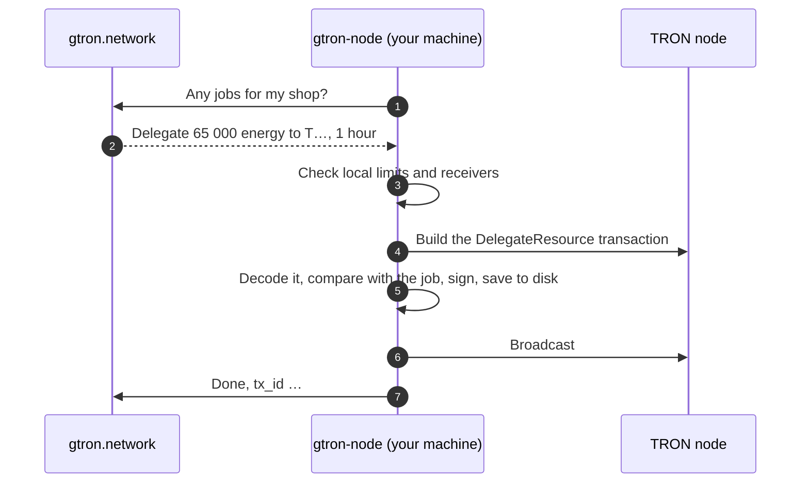

<div align="center">

<picture>
  <source media="(prefers-color-scheme: dark)" srcset=".github/assets/logo-dark.svg">
  
</picture>

### gtron-node

**Rent out your TRON energy on [gtron.network](https://gtron.network). Your private key never leaves your machine.**

[](https://github.com/Gtron-Enegry/gtron-node/releases/latest)
[](https://github.com/Gtron-Enegry/gtron-node/actions/workflows/ci.yml)
[](LICENSE)


**English** · [Русский](README.ru.md) · [简体中文](README.zh-CN.md)

</div>

---

## Install in one command

```sh
curl -fsSL https://gtron.network/install-node.sh | sh
```

The installer picks the build for your system, checks it against the release's `SHA256SUMS`, installs `gtron-node` and opens the setup wizard. Five minutes later the agent is running as a background service.

> [!TIP]
> Prefer to read before you run? The installer is [`install.sh`](install.sh) in this repository, plain POSIX sh. It only downloads from this repository's [releases](https://github.com/Gtron-Enegry/gtron-node/releases).

<details>
<summary><b>Installer options</b></summary>

```sh
curl -fsSL https://gtron.network/install-node.sh | sh -s -- --version 1.2.3   # a specific release
curl -fsSL https://gtron.network/install-node.sh | sh -s -- --no-setup        # binary only
curl -fsSL https://gtron.network/install-node.sh | sh -s -- --dir ~/bin       # install location
```

</details>

## Connect your wallet, step by step

You need about 15 minutes and a machine that stays on: Linux (any distribution, x86_64 or arm64) or macOS. A small VPS is plenty; it needs outbound HTTPS only, no open ports or domain.

### 1. A TRON wallet with staked TRX

gtron-node rents out the **energy** your staked TRX produces; the TRX itself never leaves the wallet.

1. **Install TronLink** from [tronlink.org](https://www.tronlink.org): the browser extension (Chrome, Edge, Brave) or the iOS / Android app. Only from there: fake wallets are common.
2. **Create a wallet** and write the recovery phrase down on paper. Whoever has the phrase has the wallet; no one from gtron.network will ever ask for it.
3. **Put TRX on it.** Copy the address (starts with `T`) and send TRX to it from an exchange, choosing the **TRON (TRC-20)** network.
4. **Stake for energy.** Open [tronscan.org](https://tronscan.org), press **Connect Wallet** (top right) and pick TronLink. In your account open **Stake 2.0 / Resources → Get Energy**, keep **Energy + TRON Power**, enter the amount and confirm in TronLink. Leave about 150 TRX unstaked for network fees (a delegation-only key costs about 100 TRX once, see step 5).

> [!TIP]
> Use a separate wallet for this, not the one with your savings. Unstaked TRX becomes available 14 days after you unstake it.

### 2. A shop in “Your software” mode

Sign in at [gtron.network](https://gtron.network), open **Shop → Change mode** and choose **Your software**.

### 3. The shop's provider key

In the same dialog press **Create key** (or **Shop → Settings → Provider keys**, purpose **Agent**). It looks like `pk_live_…` and is shown **once**: copy it somewhere safe for the next few minutes.

### 4. Add the wallet to the shop

**Shop → Settings → Wallets → Add wallet**: paste the wallet's address and sign the message in TronLink. The signature only proves the wallet is yours, it moves nothing. The wallet shows **Verified**.

### 5. Pick the key the agent signs with

| | A delegation-only key (recommended) | The wallet's own key |
|---|---|---|
| If the machine is hacked | the key can delegate energy, **cannot move TRX** | the attacker controls the whole wallet |
| What you do | the wizard creates the key; you allow it on tronscan ([steps](#protect-the-wallet-a-delegation-only-key)) | export the private key from TronLink ([steps](#exporting-the-wallets-own-key)) |
| Cost | TRON's fee for changing permissions (about 100 TRX, once) | none |

### 6. Install and answer the wizard

```sh
curl -fsSL https://gtron.network/install-node.sh | sh
```

| The wizard asks | You enter | Where it comes from |
|---|---|---|
| Platform API | press Enter | |
| Shop API key | `pk_live_…` | step 3 |
| Signing key | *A delegation-only key* or *The wallet's own key* | step 5 |
| Wallet address | the wallet from step 1 | only for a delegation-only key |
| The key itself | *Create a new key here*, or paste the hex key | step 5 |
| TRON node | *TronGrid*, plus its free API key | [trongrid.io](https://www.trongrid.io) → sign up → Create API key |
| Who may receive delegations? | *Any client* | the platform names the buyer for each rental |
| Safety limits | *Recommended*, or your own | [what they mean](#safety-limits) |
| How should gtron-node run? | the first option offered | systemd, Docker, launchd or by hand |

Typed secrets stay hidden. The wizard checks each answer as you go: the key with the platform, the wallet's balance and permission with the TRON node. At the end it shows where the settings and logs are. In the cabinet the **Change mode** dialog turns to *connected* within a few seconds.

## Protect the wallet: a delegation-only key

TRON lets a wallet give a second key a narrow **permission**. Give the agent a key that may only *delegate* and *reclaim* resources: even if someone takes over this machine, that key cannot move a single TRX. Your own key never leaves TronLink.

1. Run `gtron-node setup` and choose **A delegation-only key**, enter your wallet's address, then **Create a new key here**. The wizard shows the new key's address (`T…`): copy it. Leave the wizard open.
2. Open [tronscan.org/#/wallet/permissions](https://tronscan.org/#/wallet/permissions) and press **Connect Wallet** with TronLink, on the wallet that holds the stake.
3. In **Owner Permission** press **Edit Permission**, then **Add Active Permission**.
4. Fill it in:
   - **Permission Name**: anything, e.g. `gtron-node`
   - **Operations → +Add**: tick **only** *Delegate Resources* and *Reclaim Resources*, then **Save**. Nothing else: the agent refuses to run with a permission that allows more.
   - **Threshold**: `1`
   - **Authorized To**: the key address from step 1, **Weight** `1`, then **Add**
5. Press **Save** and confirm in TronLink. TRON charges a fee for changing permissions (about 100 TRX). Wait a minute for it to confirm.
6. Back in the wizard, answer the remaining questions. It finds the permission on chain by itself and installs nothing until it is right.

The agent checks again on every start. `gtron-node --check` shows which kind of key is in use. To revoke the key at any time, delete that permission on the same tronscan page.

### Exporting the wallet's own key

Only if you chose *The wallet's own key*. In the TronLink extension: the **⋮** menu → **Export Account** → **Private Key**, enter the TronLink password and copy the 64-character key. In the mobile app the same is under wallet management → export private key. Paste it only into the wizard (input is hidden), never into a chat, a site or a file of your own.

## Good practice

- **Use a separate wallet** for renting out energy, not the one that holds your savings.
- **Start small** and raise the limits once you have seen it work.
- **Prefer an allowlist** of receivers if you serve known clients.
- **Delegate from this wallet only through the agent.** Delegations made elsewhere do not
  count towards its limits.

## How it works



The agent connects out to the platform and waits for jobs. Each job is a delegation (or its return) that a client has paid for. The agent decides on its own whether to do it, and the platform cannot make it sign anything else.

## What the agent guarantees

| | |
|---|---|
| 🔑 **The key stays with you** | It is read from a file with owner-only permissions and used only to sign. It is never sent anywhere, and there is deliberately no command-line flag for it. With a [delegation-only key](#protect-the-wallet-a-delegation-only-key) it cannot move TRX even if stolen. |
| 🧾 **It signs exactly the job** | The transaction built by the TRON node is decoded and compared with the job field by field: type, wallet, receiver, resource, amount, lock. Anything else is refused. |
| 🛡️ **Your limits, not ours** | Per-delegation, per-24-hours and total-locked caps plus the receiver allowlist are checked on your machine. A compromised platform account cannot get past them. Locks are counted the way TRON keeps them: a new lock to a receiver extends the earlier ones. |
| 1️⃣ **One signature per job** | The signed transaction is saved to disk before it is broadcast. After a crash or a restart the same transaction is sent again; a second one is never signed. |
| 🌊 **Calm under failure** | If the platform or the TRON node is down, the agent backs off from 2 seconds up to a minute, so TronGrid will not ban your API key. |
| ⏹️ **Clean shutdown** | `SIGTERM` or Ctrl+C: the job in hand is finished first. A second Ctrl+C exits at once, which is also safe. |

The full list, including what the agent does *not* protect against, is in [SECURITY.md](SECURITY.md).

## Safety limits

| Limit | Variable | Recommended |
|---|---|---:|
| One delegation at most | `NODE_MAX_BALANCE_SUN` | 50 000 TRX |
| Delegated within any 24 hours | `NODE_MAX_DAILY_BALANCE_SUN` | 200 000 TRX |
| Locked at the same time | `NODE_MAX_LOCKED_BALANCE_SUN` | 500 000 TRX |
| Longest lock | `NODE_MAX_LOCK_SECONDS` | 30 days |

Amounts are in SUN in the settings file: 1 TRX = 1 000 000 SUN. A job above a limit is declined and goes to another shop.

## Everyday commands

<table>
<tr><th></th><th>Linux · systemd</th><th>Docker</th><th>macOS · launchd</th></tr>
<tr><td><b>Status</b></td><td><code>systemctl status gtron-node</code></td><td><code>docker compose ps</code></td><td><code>launchctl print gui/$(id -u)/network.gtron.node</code></td></tr>
<tr><td><b>Logs</b></td><td><code>journalctl -u gtron-node -f</code></td><td><code>docker compose logs -f</code></td><td><code>tail -f ~/.gtron-node/node.log</code></td></tr>
<tr><td><b>Restart</b></td><td><code>sudo systemctl restart gtron-node</code></td><td><code>docker compose restart</code></td><td><code>launchctl kickstart -k gui/$(id -u)/network.gtron.node</code></td></tr>
<tr><td><b>Settings</b></td><td><code>/etc/gtron-node/node.env</code></td><td><code>/opt/gtron-node</code> or <code>~/gtron-node</code></td><td><code>~/.gtron-node/node.env</code></td></tr>
<tr><td><b>State</b></td><td><code>/var/lib/gtron-node</code></td><td><code>./state</code> next to the compose file</td><td><code>~/.gtron-node/state</code></td></tr>
</table>

Docker commands run in the folder the wizard printed. Two more commands work everywhere:

```sh
gtron-node --check     # is everything ready? Reads only: takes, signs and sends nothing
gtron-node --address   # the wallet address of the configured key
```

`--check` prints the version, wallet, limits, the shop's state on the platform and the wallet's TRON balance, and exits with 0 when the agent is ready to take jobs.

## Upgrade

Run the installer again:

```sh
curl -fsSL https://gtron.network/install-node.sh | sh
```

It replaces the binary and restarts the service; settings and state stay. Jobs in progress continue where they stopped. For Docker, `docker compose pull && docker compose up -d` in the service folder.

If the platform sends a job type your version does not know, the agent declines it with a request to upgrade, and the order goes to another shop. Nothing breaks, you just miss those orders until you upgrade.

## The state directory

It holds the signed transactions and the record the 24-hour limit is counted from.

> [!IMPORTANT]
> **Keep it across upgrades and moves.** Without it the agent does not know what it has already signed: a job signed before the loss could be signed again, and the 24-hour limit starts from zero.
>
> **One directory, one agent.** A second agent on the same directory will not start. Do not run two agents with the same wallet and different directories.

## Without the wizard

Everything the wizard writes is an ordinary settings file, so you can manage it yourself.

<details>
<summary><b>Configuration file</b></summary>

Start from [`crates/node/dist/node.env.example`](crates/node/dist/node.env.example):

| Variable | Meaning |
|---|---|
| `NODE_API_URL`, `NODE_API_KEY` | Platform address and the shop's provider key (`jobs` scope) |
| `NODE_PRIVATE_KEY_FILE` | The signing key file: hex, owned by the agent's user, mode `0400` |
| `NODE_WALLET_ADDRESS`, `NODE_PERMISSION_ID` | For a delegation-only key: the wallet it signs for and the permission id |
| `TRONGRID_URL`, `TRONGRID_API_KEY` | Your TRON node, or TronGrid with an API key |
| `NODE_ALLOW_ANY_RECEIVER=1` or `NODE_ALLOWED_RECEIVERS=T…,T…` | Who may receive delegations; one of the two is required |
| `NODE_MAX_*` | [Safety limits](#safety-limits) |
| `NODE_LOCK_DELEGATIONS` | Lock delegations for the rental (default `true`); the platform counts only locked ones |
| `NODE_STATE_DIR` | State directory (default `~/.gtron-node/state`) |
| `RUST_LOG` | `error`, `warn`, `info` or `debug` |

The agent refuses to read a key file or settings file that other users can read.

```sh
gtron-node --config node.env --check
gtron-node --config node.env
```

</details>

<details>
<summary><b>systemd by hand</b></summary>

[`crates/node/dist/gtron-node.service`](crates/node/dist/gtron-node.service) starts with the exact commands: a dedicated `gtron-node` user, settings in `/etc/gtron-node`, state in `/var/lib/gtron-node`. The unit is sandboxed: the agent can only make outbound connections and write its state directory.

</details>

<details>
<summary><b>Docker by hand</b></summary>

The image is `ghcr.io/gtron-enegry/gtron-node`, distroless, running as UID 10001, for amd64 and arm64. Example: [`crates/node/dist/docker-compose.yml`](crates/node/dist/docker-compose.yml).

```sh
sudo chown 10001 wallet.key && sudo chmod 400 wallet.key
docker compose run --rm gtron-node --check
docker compose up -d
```

</details>

<details>
<summary><b>Uninstall</b></summary>

Stop the service first, then remove the files. Keep the state directory if you may come back with the same wallet.

```sh
# Linux, systemd
sudo systemctl disable --now gtron-node
sudo rm /etc/systemd/system/gtron-node.service /usr/local/bin/gtron-node
sudo rm -r /etc/gtron-node          # settings and the wallet key

# macOS, launchd
launchctl bootout gui/$(id -u)/network.gtron.node
rm ~/Library/LaunchAgents/network.gtron.node.plist

# Docker, in the service folder
docker compose down
```

</details>

## Verify a release

Every release lists `SHA256SUMS` for all archives and `install.sh`. The installer checks them for you. By hand:

```sh
sha256sum -c SHA256SUMS --ignore-missing      # macOS: shasum -a 256 -c SHA256SUMS --ignore-missing
```

Releases are built by [GitHub Actions](.github/workflows/release.yml) from the tagged source in this repository, and every file and the Docker image carry a build provenance attestation. With the [GitHub CLI](https://cli.github.com) the installer checks it too; by hand:

```sh
gh attestation verify gtron-node-x86_64-unknown-linux-musl.tar.gz -R Gtron-Enegry/gtron-node
```

## Build from source

Needs Rust (the version is pinned in [`rust-toolchain.toml`](rust-toolchain.toml)).

```sh
git clone https://github.com/Gtron-Enegry/gtron-node
cd gtron-node
cargo build --release --locked
./target/release/gtron-node setup
```

| Crate | |
|---|---|
| [`crates/node`](crates/node) | The agent and the setup wizard |
| [`crates/tron-signing`](crates/tron-signing) | Key handling, transaction checks, signing, the durable store |
| [`crates/tron-address`](crates/tron-address) | TRON address parsing |

## FAQ

<details>
<summary><b>Can gtron.network take my TRX?</b></summary>

No. The agent signs only delegations (and their return) to receivers you allowed, within your limits. Delegated TRX stays staked in your wallet; only the energy goes to the client. The agent never signs transfers.

</details>

<details>
<summary><b>Does it need a public IP or open ports?</b></summary>

No. It only makes outbound HTTPS connections, to the platform and to the TRON node.

</details>

<details>
<summary><b>The wizard says the API key is rejected</b></summary>

Make sure it is a provider key of the shop (`pk_live_…`, not a client key) and that it has the `jobs` scope. Test keys (`pk_test_…`) are for testing only.

</details>

<details>
<summary><b><code>--check</code> says "not ready"</b></summary>

It prints the reason next to each line. The usual ones: the API key is wrong or lacks the `jobs` scope, the shop is not in agent mode, or the TRON node is unreachable.

</details>

<details>
<summary><b>Can I run it on two machines for redundancy?</b></summary>

Not with the same wallet. Two agents do not know about each other's signatures and limits. Use one agent per wallet; systemd and Docker restart it if it stops.

</details>

## Security

Found a vulnerability? Please report it privately: **Security → Report a vulnerability** on this repository. Details in [SECURITY.md](SECURITY.md).

## License

[Apache License 2.0](LICENSE).

<div align="center">
<sub><a href="https://gtron.network">gtron.network</a></sub>
</div>
