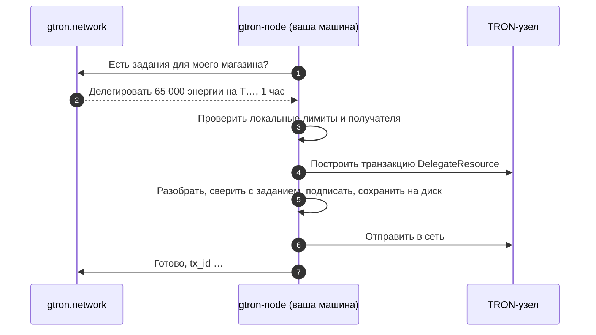

<div align="center">

<picture>
  <source media="(prefers-color-scheme: dark)" srcset=".github/assets/logo-dark.svg">
  
</picture>

### gtron-node

**Сдавайте энергию TRON в аренду на [gtron.network](https://gtron.network). Приватный ключ не покидает вашу машину.**

[](https://github.com/Gtron-Enegry/gtron-node/releases/latest)
[](https://github.com/Gtron-Enegry/gtron-node/actions/workflows/ci.yml)
[](LICENSE)


[English](README.md) · **Русский** · [简体中文](README.zh-CN.md)

</div>

---

## Установка одной командой

```sh
curl -fsSL https://gtron.network/install-node.sh | sh
```

Установщик выберет сборку под вашу систему, сверит её с `SHA256SUMS` релиза, установит `gtron-node` и запустит мастер настройки. Через пять минут агент работает как фоновая служба.

> [!TIP]
> Хотите сначала прочитать, что запускаете? Установщик лежит в этом репозитории: [`install.sh`](install.sh), обычный POSIX sh. Он скачивает только из [релизов](https://github.com/Gtron-Enegry/gtron-node/releases) этого репозитория.

<details>
<summary><b>Параметры установщика</b></summary>

```sh
curl -fsSL https://gtron.network/install-node.sh | sh -s -- --version 1.2.3   # конкретная версия
curl -fsSL https://gtron.network/install-node.sh | sh -s -- --no-setup        # только бинарник
curl -fsSL https://gtron.network/install-node.sh | sh -s -- --dir ~/bin       # куда установить
```

</details>

## Что понадобится

| | |
|---|---|
| **Магазин на gtron.network** в режиме *agent* и ключ провайдера (`pk_live_…`) со scope `jobs`. Кабинет → Магазин → API-ключи. | 🏪 |
| **Кошелёк TRON** с застейканными TRX: его приватный ключ в hex, как его экспортирует TronLink. | 👛 |
| **Машина, которая не выключается:** Linux (любой дистрибутив, x86_64 или arm64) или macOS (Apple Silicon или Intel). Небольшого VPS достаточно. | 🖥️ |
| **Только исходящий HTTPS.** Открытые порты, белый IP и домен не нужны. | 🔒 |

## Мастер настройки

`gtron-node setup` задаёт несколько вопросов и делает остальное сам. Его можно запустить повторно, чтобы поменять ответы.

| Шаг | Что спрашивает | Полезно знать |
|:---:|---|---|
| 1 | **Platform API** | Нажмите Enter, будет `https://api.gtron.network`. |
| 2 | **Ключ магазина** | Сразу проверяется на платформе. Ввод скрыт. |
| 3 | **Приватный ключ кошелька** | Ввод скрыт. Ключ сохраняется в файл, который может прочитать только агент. Мастер покажет адрес кошелька для подтверждения. |
| 4 | **Привязка кошелька** | Добавляет кошелёк в магазин и подтверждает владение: подписывает проверочное сообщение платформы. |
| 5 | **TRON-узел** | TronGrid (рекомендуется; бесплатный API-ключ повышает лимит запросов) или свой full node. |
| 6 | **Получатели** | Любой, кто арендует у вашего магазина, или только адреса из белого списка. |
| 7 | **Лимиты безопасности** | Рекомендуемые или свои. См. [лимиты](#лимиты-безопасности). |
| 8 | **Как запускать** | Системная служба (systemd), Docker, фоновая служба macOS (launchd) или вручную. Показаны только варианты, доступные на вашей машине. |

В конце мастер покажет, где лежат настройки, состояние и логи, и какими командами управлять службой.

## Как это работает



Агент сам подключается к платформе и ждёт заданий. Каждое задание — это делегирование (или его возврат), за которое заплатил клиент. Агент сам решает, выполнять ли его, и платформа не может заставить его подписать что-то другое.

## Что гарантирует агент

| | |
|---|---|
| 🔑 **Ключ остаётся у вас** | Читается из файла с правами только для владельца и используется только для подписи. Никуда не отправляется. Флага командной строки для ключа нет специально. |
| 🧾 **Подписывается ровно задание** | Транзакцию, построенную TRON-узлом, агент разбирает и сверяет с заданием по каждому полю: тип, кошелёк, получатель, ресурс, сумма, блокировка. Всё остальное отклоняется. |
| 🛡️ **Ваши лимиты, а не наши** | Лимиты на одно делегирование, за 24 часа и под блокировкой, а также белый список получателей проверяются на вашей машине. Взломанный аккаунт платформы их не обойдёт. |
| 1️⃣ **Одна подпись на задание** | Подписанная транзакция сохраняется на диск до отправки в сеть. После сбоя или перезапуска уходит та же транзакция, вторая никогда не подписывается. |
| 🌊 **Спокойно при сбоях** | Если платформа или TRON-узел недоступны, агент делает паузы от 2 секунд до минуты, и TronGrid не заблокирует ваш API-ключ. |
| ⏹️ **Аккуратная остановка** | `SIGTERM` или Ctrl+C: текущее задание сначала дорабатывается. Повторный Ctrl+C завершает сразу, это тоже безопасно. |

Полный список, включая то, от чего агент *не* защищает, — в [SECURITY.md](SECURITY.md).

## Лимиты безопасности

| Лимит | Переменная | Рекомендуемый |
|---|---|---:|
| Одно делегирование, не больше | `NODE_MAX_BALANCE_SUN` | 50 000 TRX |
| Делегировано за любые 24 часа | `NODE_MAX_DAILY_BALANCE_SUN` | 200 000 TRX |
| Под блокировкой одновременно | `NODE_MAX_LOCKED_BALANCE_SUN` | 500 000 TRX |
| Самая долгая блокировка | `NODE_MAX_LOCK_SECONDS` | 30 дней |

В файле настроек суммы указаны в SUN: 1 TRX = 1 000 000 SUN. Задание сверх лимита отклоняется и уходит другому магазину.

## Команды на каждый день

<table>
<tr><th></th><th>Linux · systemd</th><th>Docker</th><th>macOS · launchd</th></tr>
<tr><td><b>Статус</b></td><td><code>systemctl status gtron-node</code></td><td><code>docker compose ps</code></td><td><code>launchctl print gui/$(id -u)/network.gtron.node</code></td></tr>
<tr><td><b>Логи</b></td><td><code>journalctl -u gtron-node -f</code></td><td><code>docker compose logs -f</code></td><td><code>tail -f ~/.gtron-node/node.log</code></td></tr>
<tr><td><b>Перезапуск</b></td><td><code>sudo systemctl restart gtron-node</code></td><td><code>docker compose restart</code></td><td><code>launchctl kickstart -k gui/$(id -u)/network.gtron.node</code></td></tr>
<tr><td><b>Настройки</b></td><td><code>/etc/gtron-node/node.env</code></td><td><code>/opt/gtron-node</code> или <code>~/gtron-node</code></td><td><code>~/.gtron-node/node.env</code></td></tr>
<tr><td><b>Состояние</b></td><td><code>/var/lib/gtron-node</code></td><td><code>./state</code> рядом с compose-файлом</td><td><code>~/.gtron-node/state</code></td></tr>
</table>

Команды Docker выполняются в папке, которую показал мастер. Ещё две команды работают везде:

```sh
gtron-node --check     # всё ли готово? Только чтение: ничего не берёт, не подписывает и не отправляет
gtron-node --address   # адрес кошелька для настроенного ключа
```

`--check` печатает версию, кошелёк, лимиты, состояние магазина на платформе и баланс кошелька в TRON. Код выхода 0 означает, что агент готов брать задания.

## Обновление

Запустите установщик ещё раз:

```sh
curl -fsSL https://gtron.network/install-node.sh | sh
```

Он заменит бинарник и перезапустит службу, настройки и состояние сохранятся. Задания в работе продолжатся с того места, где остановились. Для Docker: `docker compose pull && docker compose up -d` в папке службы.

Если платформа пришлёт задание неизвестного вашей версии типа, агент отклонит его с просьбой обновиться, и заказ уйдёт другому магазину. Ничего не ломается, просто до обновления вы пропускаете такие заказы.

## Каталог состояния

В нём хранятся подписанные транзакции и журнал, по которому считается лимит за 24 часа.

> [!IMPORTANT]
> **Сохраняйте его при обновлениях и переездах.** Без него агент не знает, что уже подписал: задание, подписанное до потери каталога, может быть подписано повторно, а лимит за 24 часа начнёт считаться с нуля.
>
> **Один каталог — один агент.** Второй агент с тем же каталогом не запустится. Не запускайте два агента с одним кошельком и разными каталогами.

## Без мастера

Всё, что пишет мастер, — это обычный файл настроек, им можно управлять самостоятельно.

<details>
<summary><b>Файл настроек</b></summary>

Начните с [`crates/node/dist/node.env.example`](crates/node/dist/node.env.example):

| Переменная | Что это |
|---|---|
| `NODE_API_URL`, `NODE_API_KEY` | Адрес платформы и ключ провайдера магазина (scope `jobs`) |
| `NODE_PRIVATE_KEY_FILE` | Файл с ключом кошелька: hex, владелец — пользователь агента, права `0400` |
| `TRONGRID_URL`, `TRONGRID_API_KEY` | Ваш TRON-узел или TronGrid с API-ключом |
| `NODE_ALLOW_ANY_RECEIVER=1` или `NODE_ALLOWED_RECEIVERS=T…,T…` | Кому можно делегировать; нужно одно из двух |
| `NODE_MAX_*` | [Лимиты безопасности](#лимиты-безопасности) |
| `NODE_LOCK_DELEGATIONS` | Блокировать делегирование на срок аренды (по умолчанию `true`); платформа засчитывает только заблокированные |
| `NODE_STATE_DIR` | Каталог состояния (по умолчанию `.gtron-node`) |
| `RUST_LOG` | `error`, `warn`, `info` или `debug` |

Агент откажется читать файл ключа или настроек, если его могут прочитать другие пользователи.

```sh
gtron-node --config node.env --check
gtron-node --config node.env
```

</details>

<details>
<summary><b>systemd вручную</b></summary>

Файл [`crates/node/dist/gtron-node.service`](crates/node/dist/gtron-node.service) начинается с точных команд установки: отдельный пользователь `gtron-node`, настройки в `/etc/gtron-node`, состояние в `/var/lib/gtron-node`. Юнит изолирован: агенту доступны только исходящие соединения и запись в каталог состояния.

</details>

<details>
<summary><b>Docker вручную</b></summary>

Образ `ghcr.io/gtron-enegry/gtron-node`: distroless, запускается от UID 10001, для amd64 и arm64. Пример: [`crates/node/dist/docker-compose.yml`](crates/node/dist/docker-compose.yml).

```sh
sudo chown 10001 wallet.key && sudo chmod 400 wallet.key
docker compose run --rm gtron-node --check
docker compose up -d
```

</details>

<details>
<summary><b>Удаление</b></summary>

Сначала остановите службу, потом удалите файлы. Сохраните каталог состояния, если можете вернуться с тем же кошельком.

```sh
# Linux, systemd
sudo systemctl disable --now gtron-node
sudo rm /etc/systemd/system/gtron-node.service /usr/local/bin/gtron-node
sudo rm -r /etc/gtron-node          # настройки и ключ кошелька

# macOS, launchd
launchctl bootout gui/$(id -u)/network.gtron.node
rm ~/Library/LaunchAgents/network.gtron.node.plist

# Docker, в папке службы
docker compose down
```

</details>

## Проверка релиза

В каждом релизе есть `SHA256SUMS` для всех архивов и `install.sh`. Установщик сверяет их сам. Вручную:

```sh
sha256sum -c SHA256SUMS --ignore-missing      # macOS: shasum -a 256 -c SHA256SUMS --ignore-missing
```

Релизы собирает [GitHub Actions](.github/workflows/release.yml) из исходников этого репозитория по тегу.

## Сборка из исходников

Нужен Rust (версия закреплена в [`rust-toolchain.toml`](rust-toolchain.toml)).

```sh
git clone https://github.com/Gtron-Enegry/gtron-node
cd gtron-node
cargo build --release --locked
./target/release/gtron-node setup
```

| Крейт | |
|---|---|
| [`crates/node`](crates/node) | Агент и мастер настройки |
| [`crates/tron-signing`](crates/tron-signing) | Работа с ключом, проверка транзакций, подпись, хранилище подписанного |
| [`crates/tron-address`](crates/tron-address) | Разбор адресов TRON |

## Вопросы и ответы

<details>
<summary><b>Может ли gtron.network забрать мои TRX?</b></summary>

Нет. Агент подписывает только делегирования (и их возврат) разрешённым вами получателям и в пределах ваших лимитов. Делегированные TRX остаются застейканными в вашем кошельке, клиенту уходит только энергия. Переводы агент не подписывает никогда.

</details>

<details>
<summary><b>Нужен ли белый IP или открытые порты?</b></summary>

Нет. Агент только сам подключается по HTTPS к платформе и к TRON-узлу.

</details>

<details>
<summary><b>Мастер пишет, что API-ключ отклонён</b></summary>

Проверьте, что это ключ провайдера магазина (`pk_live_…`, а не клиентский ключ) и что у него есть scope `jobs`. Тестовые ключи (`pk_test_…`) — только для тестов.

</details>

<details>
<summary><b><code>--check</code> пишет «not ready»</b></summary>

Причина указана рядом с каждой строкой. Чаще всего: неверный API-ключ или у него нет scope `jobs`, магазин не в режиме agent, TRON-узел недоступен.

</details>

<details>
<summary><b>Можно запустить на двух машинах для надёжности?</b></summary>

Не с одним кошельком. Два агента не знают о подписях и лимитах друг друга. Один кошелёк — один агент; systemd и Docker сами перезапустят его, если он остановится.

</details>

## Безопасность

Нашли уязвимость? Сообщите о ней приватно: **Security → Report a vulnerability** в этом репозитории. Подробнее в [SECURITY.md](SECURITY.md).

## Лицензия

[Apache License 2.0](LICENSE).

<div align="center">
<sub><a href="https://gtron.network">gtron.network</a></sub>
</div>
