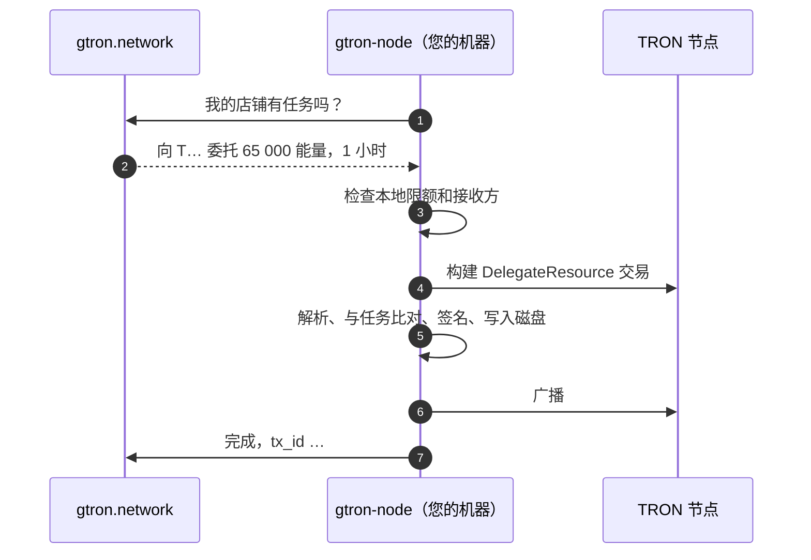

<div align="center">

<picture>
  <source media="(prefers-color-scheme: dark)" srcset=".github/assets/logo-dark.svg">
  
</picture>

### gtron-node

**在 [gtron.network](https://gtron.network) 出租您的 TRON 能量。私钥永远不会离开您的机器。**

[](https://github.com/Gtron-Enegry/gtron-node/releases/latest)
[](https://github.com/Gtron-Enegry/gtron-node/actions/workflows/ci.yml)
[](LICENSE)


[English](README.md) · [Русский](README.ru.md) · **简体中文**

</div>

---

## 一条命令安装

```sh
curl -fsSL https://gtron.network/install-node.sh | sh
```

安装程序会为您的系统选择对应的构建，用发布中的 `SHA256SUMS` 校验，安装 `gtron-node` 并打开设置向导。五分钟后，代理就会作为后台服务运行。

> [!TIP]
> 想先看看要运行的是什么？安装程序就是本仓库中的 [`install.sh`](install.sh)，纯 POSIX sh 脚本。它只从本仓库的 [Releases](https://github.com/Gtron-Enegry/gtron-node/releases) 下载。

<details>
<summary><b>安装选项</b></summary>

```sh
curl -fsSL https://gtron.network/install-node.sh | sh -s -- --version 1.2.3   # 指定版本
curl -fsSL https://gtron.network/install-node.sh | sh -s -- --no-setup        # 只安装程序
curl -fsSL https://gtron.network/install-node.sh | sh -s -- --dir ~/bin       # 安装位置
```

</details>

## 准备工作

| | |
|---|---|
| **gtron.network 上的店铺**，处于 *agent* 模式，并有一个带 `jobs` 权限的提供方 API 密钥（`pk_live_…`）。控制台 → 店铺 → API 密钥。 | 🏪 |
| **TRON 钱包**，已质押 TRX：需要其十六进制私钥（TronLink 导出的格式）。 | 👛 |
| **一台持续开机的机器：** Linux（任意发行版，x86_64 或 arm64）或 macOS（Apple Silicon 或 Intel）。一台小型 VPS 就足够。 | 🖥️ |
| **只需出站 HTTPS。** 不需要开放端口、公网 IP 或域名。 | 🔒 |

## 设置向导

`gtron-node setup` 会问几个问题，其余的自动完成。随时可以再次运行以修改设置。

| 步骤 | 询问内容 | 提示 |
|:---:|---|---|
| 1 | **Platform API** | 直接回车即为 `https://api.gtron.network`。 |
| 2 | **店铺 API 密钥** | 立即向平台验证。输入不会显示。 |
| 3 | **钱包私钥** | 输入不会显示，保存在只有代理能读取的文件中。向导会显示钱包地址供您确认。 |
| 4 | **绑定钱包** | 将钱包添加到店铺，并通过签署平台的验证消息证明您拥有它。 |
| 5 | **TRON 节点** | TronGrid（推荐；免费的 API 密钥可提高请求限额）或您自己的全节点。 |
| 6 | **接收方** | 任何在您店铺租用的人，或仅限白名单中的地址。 |
| 7 | **安全限额** | 使用推荐值或自定义。见 [安全限额](#安全限额)。 |
| 8 | **运行方式** | 系统服务（systemd）、Docker、macOS 后台服务（launchd）或手动运行。只列出您的机器支持的选项。 |

最后，向导会显示设置、状态和日志的位置，以及管理服务的命令。

## 工作原理



代理主动连接平台并等待任务。每个任务都是客户已付费的一次委托（或其收回）。是否执行由代理自己决定，平台无法让它签署任何其他内容。

## 代理的保证

| | |
|---|---|
| 🔑 **私钥留在您手中** | 从仅所有者可读的文件中读取，只用于签名，从不发送到任何地方。特意没有用于传入私钥的命令行参数。 |
| 🧾 **只签署任务本身** | TRON 节点构建的交易会被解析，并逐字段与任务比对：类型、钱包、接收方、资源、数量、锁定。任何不符都会被拒绝。 |
| 🛡️ **您的限额，而不是我们的** | 单次委托、24 小时内、锁定总额三项限额以及接收方白名单都在您的机器上检查。即使平台账户被攻破也无法绕过。 |
| 1️⃣ **每个任务只签一次** | 签名后的交易在广播前写入磁盘。崩溃或重启后会重新发送同一笔交易，绝不会签第二笔。 |
| 🌊 **故障时保持冷静** | 平台或 TRON 节点不可用时，代理会从 2 秒到 1 分钟逐步退避，TronGrid 不会封禁您的 API 密钥。 |
| ⏹️ **平稳停止** | `SIGTERM` 或 Ctrl+C：先完成手头的任务。再按一次 Ctrl+C 立即退出，这同样安全。 |

完整说明（包括代理*不*防护的情况）见 [SECURITY.md](SECURITY.md)。

## 安全限额

| 限额 | 变量 | 推荐值 |
|---|---|---:|
| 单次委托上限 | `NODE_MAX_BALANCE_SUN` | 50 000 TRX |
| 任意 24 小时内委托总量 | `NODE_MAX_DAILY_BALANCE_SUN` | 200 000 TRX |
| 同时锁定总量 | `NODE_MAX_LOCKED_BALANCE_SUN` | 500 000 TRX |
| 最长锁定时间 | `NODE_MAX_LOCK_SECONDS` | 30 天 |

设置文件中的数量以 SUN 为单位：1 TRX = 1 000 000 SUN。超出限额的任务会被拒绝，转给其他店铺。

## 常用命令

<table>
<tr><th></th><th>Linux · systemd</th><th>Docker</th><th>macOS · launchd</th></tr>
<tr><td><b>状态</b></td><td><code>systemctl status gtron-node</code></td><td><code>docker compose ps</code></td><td><code>launchctl print gui/$(id -u)/network.gtron.node</code></td></tr>
<tr><td><b>日志</b></td><td><code>journalctl -u gtron-node -f</code></td><td><code>docker compose logs -f</code></td><td><code>tail -f ~/.gtron-node/node.log</code></td></tr>
<tr><td><b>重启</b></td><td><code>sudo systemctl restart gtron-node</code></td><td><code>docker compose restart</code></td><td><code>launchctl kickstart -k gui/$(id -u)/network.gtron.node</code></td></tr>
<tr><td><b>设置</b></td><td><code>/etc/gtron-node/node.env</code></td><td><code>/opt/gtron-node</code> 或 <code>~/gtron-node</code></td><td><code>~/.gtron-node/node.env</code></td></tr>
<tr><td><b>状态目录</b></td><td><code>/var/lib/gtron-node</code></td><td>compose 文件旁的 <code>./state</code></td><td><code>~/.gtron-node/state</code></td></tr>
</table>

Docker 命令在向导显示的目录中运行。另外两个命令在任何环境下都可用：

```sh
gtron-node --check     # 一切就绪了吗？只读：不领取、不签名、不发送
gtron-node --address   # 已配置私钥对应的钱包地址
```

`--check` 会显示版本、钱包、限额、店铺在平台上的状态以及钱包的 TRON 余额，代理可以接任务时退出码为 0。

## 升级

再次运行安装程序：

```sh
curl -fsSL https://gtron.network/install-node.sh | sh
```

它会替换程序并重启服务，设置和状态保持不变。进行中的任务会从中断处继续。Docker 用户在服务目录中运行 `docker compose pull && docker compose up -d`。

如果平台发来您的版本不认识的任务类型，代理会以“请升级”为由拒绝，订单转给其他店铺。不会出错，只是在升级之前会错过这类订单。

## 状态目录

其中保存已签名的交易，以及计算 24 小时限额所用的记录。

> [!IMPORTANT]
> **升级和迁移时请保留它。** 没有它，代理不知道自己已经签过什么：丢失前签过的任务可能被再签一次，24 小时限额也会从零开始计算。
>
> **一个目录，一个代理。** 使用同一目录的第二个代理无法启动。不要用同一个钱包、不同的目录运行两个代理。

## 不使用向导

向导写入的只是普通的设置文件，您也可以自己管理。

<details>
<summary><b>设置文件</b></summary>

从 [`crates/node/dist/node.env.example`](crates/node/dist/node.env.example) 开始：

| 变量 | 含义 |
|---|---|
| `NODE_API_URL`、`NODE_API_KEY` | 平台地址和店铺的提供方密钥（`jobs` 权限） |
| `NODE_PRIVATE_KEY_FILE` | 钱包私钥文件：十六进制，属于运行代理的用户，权限 `0400` |
| `TRONGRID_URL`、`TRONGRID_API_KEY` | 您的 TRON 节点，或带 API 密钥的 TronGrid |
| `NODE_ALLOW_ANY_RECEIVER=1` 或 `NODE_ALLOWED_RECEIVERS=T…,T…` | 允许谁接收委托，二者必选其一 |
| `NODE_MAX_*` | [安全限额](#安全限额) |
| `NODE_LOCK_DELEGATIONS` | 在租期内锁定委托（默认 `true`）；平台只计入已锁定的委托 |
| `NODE_STATE_DIR` | 状态目录（默认 `.gtron-node`） |
| `RUST_LOG` | `error`、`warn`、`info` 或 `debug` |

如果私钥文件或设置文件可被其他用户读取，代理会拒绝读取。

```sh
gtron-node --config node.env --check
gtron-node --config node.env
```

</details>

<details>
<summary><b>手动配置 systemd</b></summary>

[`crates/node/dist/gtron-node.service`](crates/node/dist/gtron-node.service) 开头就是完整的安装命令：专用用户 `gtron-node`，设置位于 `/etc/gtron-node`，状态位于 `/var/lib/gtron-node`。该单元启用了沙箱：代理只能发起出站连接并写入自己的状态目录。

</details>

<details>
<summary><b>手动配置 Docker</b></summary>

镜像为 `ghcr.io/gtron-enegry/gtron-node`，基于 distroless，以 UID 10001 运行，支持 amd64 和 arm64。示例：[`crates/node/dist/docker-compose.yml`](crates/node/dist/docker-compose.yml)。

```sh
sudo chown 10001 wallet.key && sudo chmod 400 wallet.key
docker compose run --rm gtron-node --check
docker compose up -d
```

</details>

<details>
<summary><b>卸载</b></summary>

先停止服务，再删除文件。如果以后可能用同一个钱包回来，请保留状态目录。

```sh
# Linux，systemd
sudo systemctl disable --now gtron-node
sudo rm /etc/systemd/system/gtron-node.service /usr/local/bin/gtron-node
sudo rm -r /etc/gtron-node          # 设置和钱包私钥

# macOS，launchd
launchctl bootout gui/$(id -u)/network.gtron.node
rm ~/Library/LaunchAgents/network.gtron.node.plist

# Docker，在服务目录中
docker compose down
```

</details>

## 校验发布

每个发布都附有所有压缩包和 `install.sh` 的 `SHA256SUMS`。安装程序会自动校验。手动校验：

```sh
sha256sum -c SHA256SUMS --ignore-missing      # macOS：shasum -a 256 -c SHA256SUMS --ignore-missing
```

发布由 [GitHub Actions](.github/workflows/release.yml) 根据本仓库带标签的源码构建。

## 从源码构建

需要 Rust（版本固定在 [`rust-toolchain.toml`](rust-toolchain.toml) 中）。

```sh
git clone https://github.com/Gtron-Enegry/gtron-node
cd gtron-node
cargo build --release --locked
./target/release/gtron-node setup
```

| Crate | |
|---|---|
| [`crates/node`](crates/node) | 代理和设置向导 |
| [`crates/tron-signing`](crates/tron-signing) | 私钥处理、交易校验、签名、持久化存储 |
| [`crates/tron-address`](crates/tron-address) | TRON 地址解析 |

## 常见问题

<details>
<summary><b>gtron.network 能拿走我的 TRX 吗？</b></summary>

不能。代理只在您的限额内、向您允许的接收方签署委托（及其收回）。委托的 TRX 仍质押在您的钱包中，转给客户的只是能量。代理从不签署转账。

</details>

<details>
<summary><b>需要公网 IP 或开放端口吗？</b></summary>

不需要。代理只主动发起到平台和 TRON 节点的出站 HTTPS 连接。

</details>

<details>
<summary><b>向导提示 API 密钥被拒绝</b></summary>

请确认这是店铺的提供方密钥（`pk_live_…`，而不是客户密钥），并且具有 `jobs` 权限。测试密钥（`pk_test_…`）仅用于测试。

</details>

<details>
<summary><b><code>--check</code> 显示 “not ready”</b></summary>

每一行旁边都写明了原因。最常见的是：API 密钥错误或缺少 `jobs` 权限、店铺不在 agent 模式、TRON 节点无法访问。

</details>

<details>
<summary><b>可以在两台机器上运行以提高可靠性吗？</b></summary>

同一个钱包不行。两个代理互不知道对方的签名和限额。一个钱包对应一个代理；如果它停止，systemd 和 Docker 会自动重启它。

</details>

## 安全

发现漏洞？请私下报告：在本仓库中点击 **Security → Report a vulnerability**。详情见 [SECURITY.md](SECURITY.md)。

## 许可证

[Apache License 2.0](LICENSE)。

<div align="center">
<sub><a href="https://gtron.network">gtron.network</a></sub>
</div>
